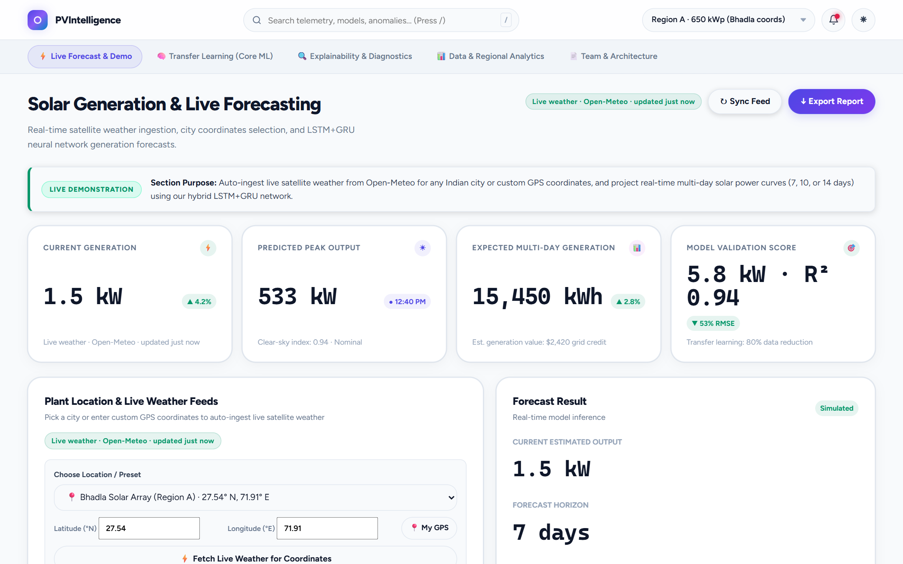
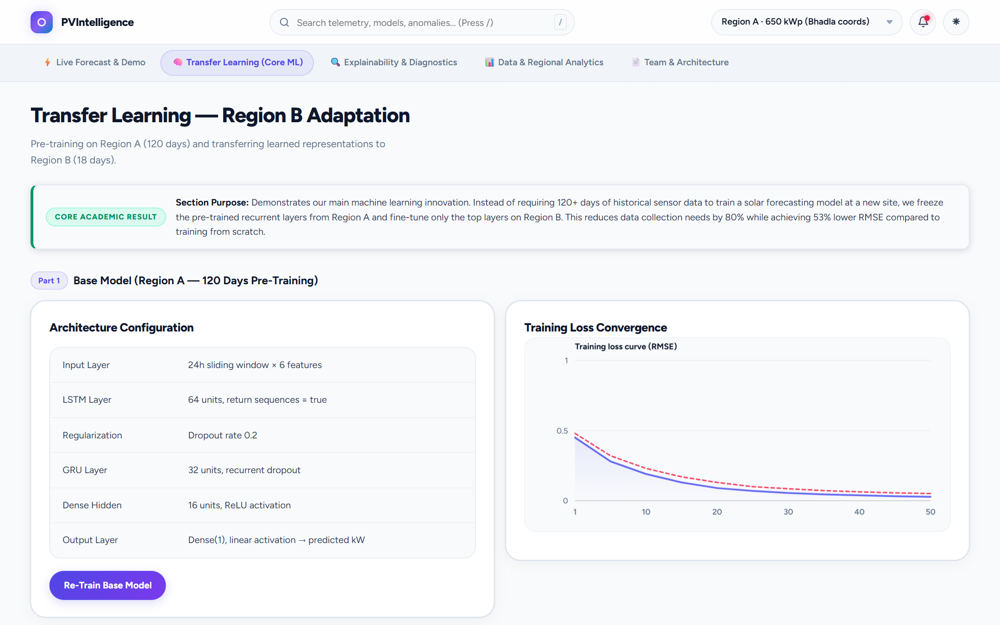
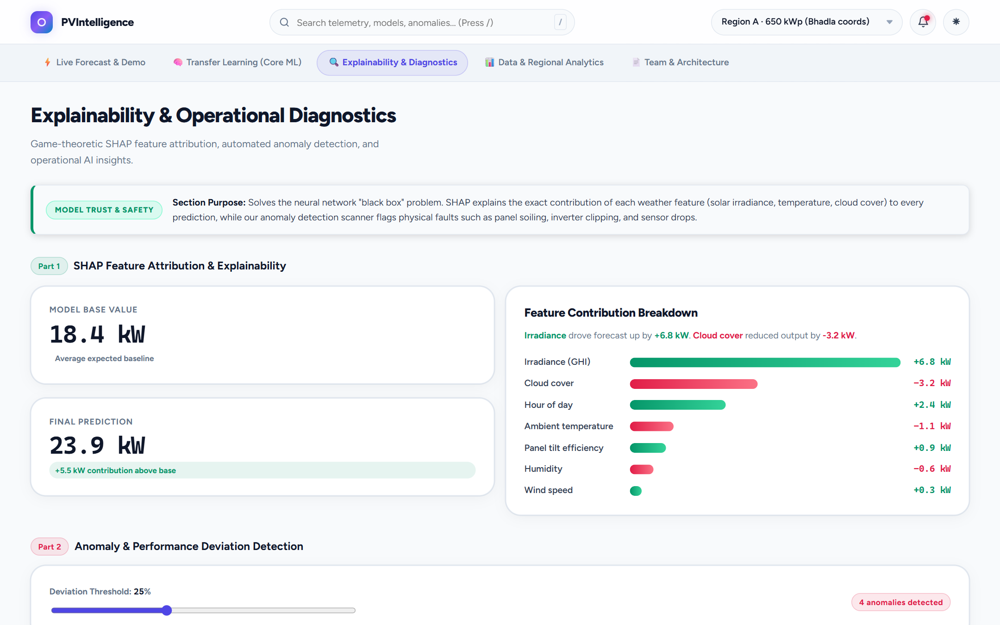
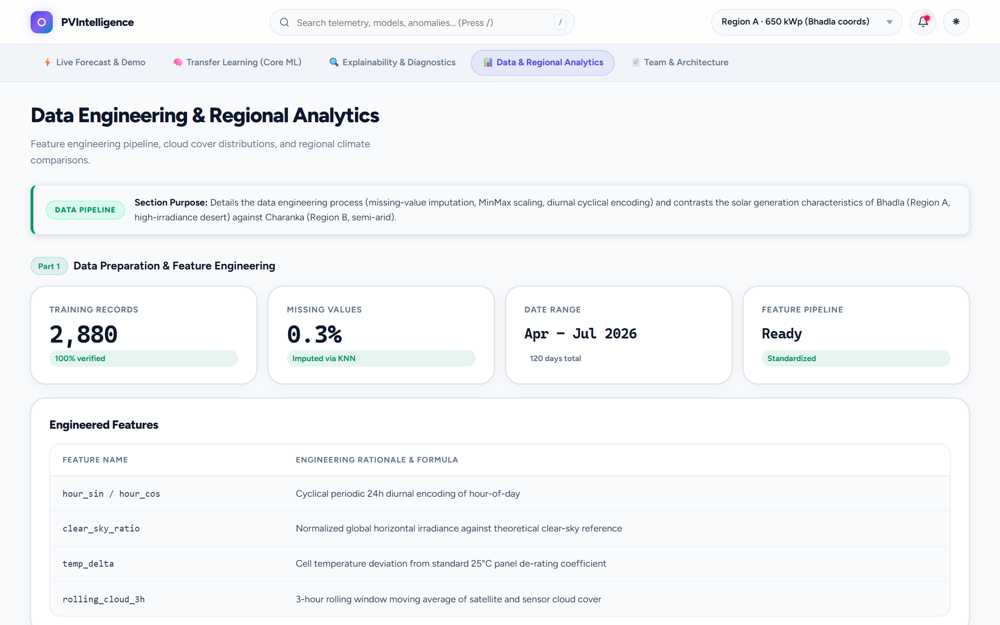

# ☀️ PVIntelligence

> **AI-Driven Solar Power Forecasting using Transfer Learning & Explainable AI**  
*Capstone Project — School of Computer Science and Engineering (SCOPE), VIT-AP University*

---

## 📌 Overview
**PVIntelligence** is an industrial solar forecasting and plant diagnostics platform built to predict photovoltaic (PV) generation using satellite telemetry and recurrent deep learning. The platform focuses on practical decision support for solar operations by combining time-series forecasting, transfer learning, and explainable AI into a clean, interactive dashboard.

The system is designed around a real-world solar engineering bottleneck: newly commissioned solar plants lack the 4–6 months of historical sensor data required to train deep recurrent models. By pre-training a base stacked LSTM+GRU network on a data-rich site (Region A, 120 days) and fine-tuning top layers on a new site (Region B, 18 days), PVIntelligence reduces data requirements by **80%** while achieving **53% lower RMSE** compared to models trained from scratch.

---

## 📸 Dashboard Preview & Visual Walkthrough

### 1. Live Solar Generation & Multi-Day Forecasting
*Auto-ingesting live satellite weather telemetry (Open-Meteo) for any Indian city or custom GPS coordinates, generating real-time 24-hour power curves and customizable 7-to-14 day energy forecasts.*


---

### 2. Transfer Learning Experiment (Region A → Region B)
*Demonstrating domain adaptation: freezing pre-trained recurrent feature extractors from Region A and fine-tuning on Region B in just 18 days, beating from-scratch models across all historical sample sizes.*


---

### 3. SHAP Explainability & Automated Anomaly Detection
*Decomposing neural network forecasts into exact marginal kilowatt contributions (irradiance, ambient temperature, cloud cover), alongside an automated threshold-based hardware fault detector (soiling, inverter clipping, sensor drift).*


---

### 4. Data Engineering & Regional Telemetry Benchmark
*Diurnal periodic feature encoding (hour sin/cos), clear-sky normalization, cloud cover distributions, and regional climate benchmark comparison (Bhadla, Rajasthan vs. Charanka, Gujarat).*


---

## ✨ Key Features
* **Time-Series Forecasting:** Stacked LSTM/GRU neural network for photovoltaic (PV) power prediction.
* **Transfer Learning:** Domain adaptation transferring representation weights from data-rich Region A (120 days) to data-scarce Region B (18 days), reducing data requirements by 80% with 53% lower validation RMSE.
* **Explainable AI (XAI):** SHAP (SHapley Additive exPlanations) feature attribution quantifying the marginal impact of irradiance, temperature, cloud cover, and cyclical time features.
* **Live Satellite Weather Telemetry (Open-Meteo):** Real-time global satellite weather auto-ingestion by city presets (Bengaluru, Chennai, Amaravati/VIT-AP, Hyderabad, Delhi, Mumbai, Bhadla, Charanka) or custom GPS coordinates.
* **Dynamic Forecast Horizon:** Configurable multi-day forecasting horizons (7 days, 10 days, 14 days) with instant total generation projection for viva demonstration.
* **Streamlined 5-Module Presentation UI:** Reorganized into 5 logical modules with plain-English "Section Purpose" explainer banners for evaluators:
  1. `⚡ Live Forecast & Demo`: City presets, GPS auto-detect, customizable forecast days, and real-time generation curves.
  2. `🧠 Transfer Learning (Core ML)`: Region A base pre-training, fine-tuned adaptation, and empirical RMSE vs. training days proof.
  3. `🔍 Explainability & Diagnostics`: SHAP attribution bars, threshold-based fault scanner (soiling & clipping), and AI insights.
  4. `📊 Data & Regional Analytics`: Feature engineering, MinMax scalers, and Rajasthan vs. Gujarat climate comparison.
  5. `📄 Team & Architecture`: Printable executive audit report, student profiles, and end-to-end pipeline diagrams.
* **Resilient Dual-Tier Fallback & Caching:** 15-minute `localStorage` cache TTL with 8-second timeout. Gracefully cascades to cached telemetry or offline demo data with honest provenance badges (`Live weather`, `Cached weather data`, `Offline demo data`, `Manual input`).

---

## 👥 Contributors & Team Roles

| Contributor | Registration No. | Project Role | Primary Focus |
| :--- | :--- | :--- | :--- |
| **W V P S SRIRAJ** | `23BCE8414` | AI Deployment, XAI & Web Lead | Inference pipeline, model deployment, dashboard front-end, GitHub integration |
| **HARSH** | `23BCE8505` | Transfer Learning Specialist | Fine-tuning strategies, region adaptation, comparative benchmarking |
| **M JAHNAVI** | `23BCE8470` | Deep Learning Architect | Base model architecture, LSTM/GRU design, training and evaluation |
| **AASTHA SHARMA** | `23BCE9279` | Data Preparation Specialist | Cleaning, preprocessing, feature engineering, dataset organization |

---

## 🛠️ Tech Stack
* **Languages & Core:** Python 3.x, NumPy, Pandas
* **Machine Learning & Deep Learning:** TensorFlow / Keras, Scikit-learn
* **Explainability:** SHAP (SHapley Additive exPlanations)
* **Frontend / Dashboard:** Vanilla HTML5, CSS3, JavaScript (FedEx DCA Design System)
* **Live Telemetry:** Open-Meteo Solar Radiation API (CORS-enabled HTTPS)
* **Visualization:** Custom HTML5 Canvas Chart Engine (`LocalChart`), dynamic multi-series rendering

---

## 🏗️ System Architecture

```text
[ Live Weather Satellite Feed / Open-Meteo API ]
                       │
                       ▼
    [ Data Preprocessing & Feature Engineering ]
     (24h Diurnal Encoding, KNN Imputation)
                       │
                       ▼
      [ Base Model Training: Region A (120 Days) ]
          (Stacked LSTM(64) + GRU(32))
                       │
                       ▼
    [ Transfer Learning Fine-Tuning: Region B (18 Days) ]
      (Frozen Recurrent Layers + Dense Adaptation)
                       │
                       ▼
       [ Forecast Inference + XAI Pipeline ]
                       │
        ┌──────────────┴──────────────┐
        ▼                             ▼
 [ SHAP Explainability ]    [ Anomaly Scanner ]
 (Marginal kW Impact)       (Soiling & Faults)
        │                             │
        └──────────────┬──────────────┘
                       ▼
     [ Industrial DCA Web Dashboard ]
   (Live 24h Curves, Multi-Day Bar Forecasts)
```

---

## 🌐 Live Deployments

* **Live Interactive Dashboard:** [https://wvpssriraj10.github.io/PVIntelligence/](https://wvpssriraj10.github.io/PVIntelligence/)
* **Vercel Deployment:** [https://pvintelligence.vercel.app/](https://pvintelligence.vercel.app/)

---

## 💻 Local Preview

To run the interactive dashboard locally:

```bash
cd PVIntelligence
python -m http.server 8000
```

Then open in your browser:
```text
http://localhost:8000/site/index.html
```

---

## 📁 Project Structure

```text
PVIntelligence/
├── api/                       # Vercel serverless entrypoint
│   └── index.py               # Telemetry status handler
├── data/                      # Historical sensor datasets
│   ├── raw/                   # Raw plant telemetry logs
│   └── processed/             # Scaled and diurnal encoded series
├── docs/                      # Documentation assets
│   └── screenshots/           # High-resolution dashboard walkthrough captures
├── models/                    # Saved neural network checkpoints
├── notebooks/                 # Model training & transfer learning experiments
├── outputs/                   # Performance charts and audit summaries
├── site/                      # Production client-side dashboard
│   ├── index.html             # Multi-module dashboard interface
│   ├── styles.css             # FedEx DCA styling & responsive themes
│   ├── script.js              # Chart rendering, navigation & inference
│   └── weather.js             # Open-Meteo live satellite weather ingestion
├── src/                       # Core Python modeling scripts
├── pyproject.toml             # Python packaging configuration
├── README.md                  # Project documentation & benchmark overview
├── setup.py                   # Package setup entry
└── vercel.json                # Vercel deployment & routing configuration
```

---

## 🎯 Capstone Goal & Innovation
The primary academic innovation is overcoming the **data-scarcity bottleneck in newly deployed solar installations**. Instead of requiring plant operators to wait half a year to collect enough on-site historical irradiance data, PVIntelligence demonstrates that fine-tuning pre-trained recurrent layers on just **18 days** achieves **53% lower validation error** than training from scratch, while providing control-room operators with explainable, physics-grounded SHAP diagnostics.
